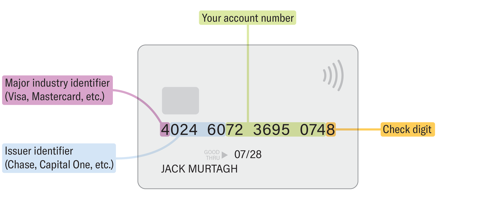
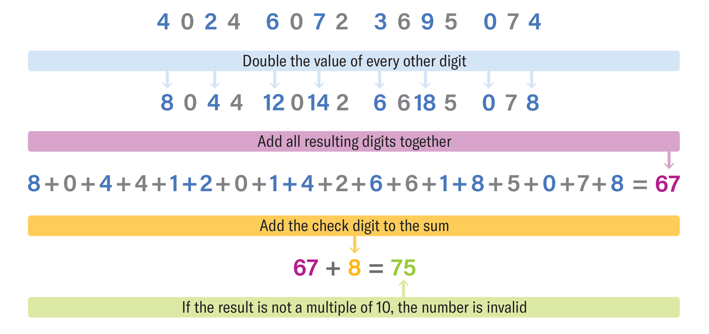

# 🔍 Luhn Algorithm Validation

## 🌐 Languages
- [🇬🇧 English](README.md)
- [🇮🇷 Persian](README_FA.md)

## 📑 Table of Contents
- [Project Description](#project-description)
- [Project Origin Story](#project-origin-story)
- [What is the Luhn Algorithm?](#what-is-the-luhn-algorithm)
- [How It Works](#how-does-the-luhn-algorithm-work)
- [History](#history-and-inventor)
- [Use Cases](#use-cases)
- [Project Goals](#project-goals)
- [Project Structure](#project-structure)
- [Clean Code Principles](#clean-code-principles-and-clean-architecture)
- [How to Run](#how-to-run-the-project)
- [License](#license)

---
<a id="project-description"></a>
## 📖 Project Description
This project is a **clean and modular** implementation of the Luhn algorithm using JavaScript, which is used to validate numbers such as bank card numbers.

> **💡 Note:** In addition to the algorithm itself, the development path of this project is based on hands-on learning and test-driven practice.


## 🛜 Live Demo

<div align="center">
   <a href="https://mohammad-khiabani.github.io/Luhn-Algorithm/">
      
   </a>
   <br/>
   <a style="font-size:Bold" href="https://mohammad-khiabani.github.io/Luhn-Algorithm/">
     
   </a>
</div>


---
<a id="project-origin-story"></a>
## 📜 Project Origin Story
>A few nights ago, while reading short programming articles in Telegram channels, I came across a post titled "Luhn Algorithm." The post only mentioned that banks use an algorithm by this name to validate card numbers on the client side before sending the request to the server.

>After reading the post, I decided to start researching the topic and learn how the algorithm works. After understanding its logic, I began writing the code. Initially, my goal was simply to write code for myself—both to gain more skill in implementing algorithms and to actually test whether this concept held true or not. After writing the code, testing it, and receiving positive results, I decided to create a user interface (UI) for the code and publish it on my GitHub account for public use, so that anyone with even basic web knowledge could benefit from this project.

<a id="what-is-the-luhn-algorithm"></a>
## ❓ What is the Luhn Algorithm?
The **Luhn Algorithm** (also known as the Luhn formula), which is also famous as the **"Modulus 10"** algorithm, is a simple formula for validating the correctness (`checksum`) of many identification numbers.

> **⚠️ Attention:** This algorithm can detect common errors such as typos or digit transpositions, but it does not guarantee that a number is actually issued or valid by a bank.

<a id="how-does-the-luhn-algorithm-work"></a>
## ⚙️ How does the **Luhn** algorithm work?



| Step | Operation | Description |
|------|-----------|-------------|
| 1 | Select the check digit | The last digit (`8`) |
| 2 | Numbering from the right | Positions start from 1 |
| 3 | Double even-position digits | Digits in positions 2, 4, 6, ... |
| 4 | Reduce two-digit numbers | If > 9, subtract 9 |
| 5 | Sum all digits | Total of all digits |
| 6 | Divisibility check | `(sum % 10) == 0` |



**Sample Code:**
```javascript
// Steps 3-4 in practice
const luhnHandler = (digits) =>
  digits.reduceRight((total, num, i) => {
    const reverceIndex = digits.length - 1 - i;
    if (reverceIndex % 2 === 1) {
      const doubled = num * 2;
      return total + (doubled > 9 ? doubled - 9 : doubled);
    }
    return total + num;
  }, 0);
```

---
<a id="history-and-inventor"></a>
## 📜 History and Inventor

| Section | Information |
|--------|-------------|
| **Inventor** | Hans Peter Luhn |
| **Year** | 1954 |
| **Company** | IBM |
| **Original Purpose** | Fast and low-cost validation of numeric identifiers |

---
<a id="use-cases"></a>
## 🎯 Use Cases

| Field | Usage |
|------|-------|
| 💳 Banking | Bank card numbers |
| 📱 Telecommunications | Mobile phone IMEI numbers |
| 🏛️ Government | Some national identifiers |
| 🔒 Security | Form validation |
| 🛒 Commerce | Online payment gateways |

---
<a id="project-goals"></a>
## 🎯 Project Goals
- ✅ Deep understanding of the Luhn algorithm
- ✅ Practice writing clean and functional code
- ✅ Separation of concerns and modular design
- ✅ Writing testable and maintainable code
- ✅ Using automated tests with Jest
- ✅ Providing easy usage through a UI

---
<a id="project-structure"></a>
## 📁 Project Structure
```text
luhnAlgorithm
│
├── index.html              # Main user interface
├── css/
│   └── styles.css         # Project styles
├── js/
│   ├── app.js             # Main application logic
│   └── utils/
│       └── luhnAlgorithm.js  # Algorithm implementation
├── tests/
│   └── luhn.test.js       # Jest tests
├── package.json           # npm configuration
└── README.md              # This file
```

---
<a id="clean-code-principles-and-clean-architecture"></a>
## 🧹 Clean Code Principles and Clean Architecture

| Principle | Implementation |
|----------|----------------|
| **Modularity** | Functions separated in `luhnAlgorithm.js` |
| **Readability** | Meaningful naming (`luhnCheck`, `doubleAndReduce`) |
| **Testability** | Comprehensive tests with Jest |
| **Pure Functions** | No side effects, deterministic output |
| **Separation of Concerns** | UI separated from business logic |

---
<a id="how-to-run-the-project"></a>
## 🚀 How to Run the Project

> **Prerequisite:** Install [Node.js](https://nodejs.org) and npm

### 1. Install dependencies
```bash
npm install
```

## 2. Run the project
```bash
npm start
```
Or open the `index.html` file directly in the browser.

## 3. Run tests
```bash
npm test
```
<a id="license"></a>
## 📄 License
> This project is published under the MIT License.

---

**⭐ If you found this project useful, don’t forget to give it a star!**

---

Created by [Mohammad Khiabani](https://github.com/Mohammad-Khiabani)
