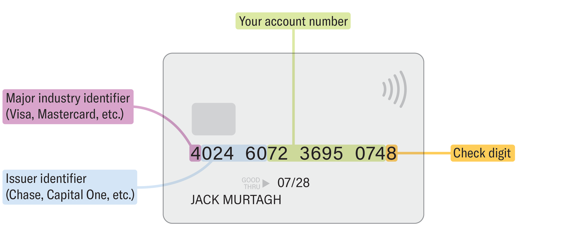
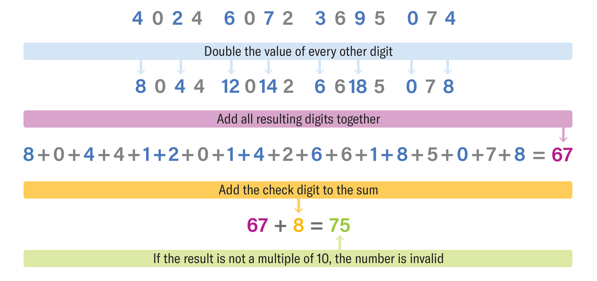

# 🔍 اعتبارسنجی الگوریتم لون (Luhn Algorithm)

## 📑 فهرست
- [توضیح پروژه](#توضیح-پروژه)
- [داستان شکل‌گیری](#داستان-شکل-گیری-پروژه)
- [الگوریتم Luhn چیست؟](#الگوریتم-luhn-چیست)
- [نحوه کار](#الگوریتم-luhn-چگونه-کار-می-کند)
- [تاریخچه](#تاریخچه-و-ابداع-کننده)
- [کاربردها](#کاربردها)
- [اهداف پروژه](#اهداف-پروژه)
- [ساختار پروژه](#ساختار-پروژه)
- [اصول Clean Code](#اصول-Clean-Code-و-معماری-تمیز)
- [نحوه اجرا](#نحوه-اجرای-پروژه)
- [لایسنس](#لایسنس)

---
<a id="توضیح-پروژه"></a>
## 📖 توضیح پروژه
این پروژه یک پیاده‌سازی **تمیز و ماژولار** از الگوریتم لون با استفاده از جاوااسکریپت است که برای اعتبارسنجی شماره‌هایی مانند شماره کارت بانکی استفاده می‌شود.

> **💡 نکته:** علاوه بر خود الگوریتم، مسیر شکل‌گیری این پروژه بر پایه‌ی یادگیری عملی و تست‌محوری بوده است.

---
<a id="داستان-شکل-گیری-پروژه"></a>
## 📜 داستان شکل‌گیری پروژه
>چند شب پیش در حال مطالعه مقاله های کوتاه در حوزه ی برنامه نویسی در کانال های تلگرامی بودم که با پستی با عنوان الگوریتم luhn  مواجه شدم در پست فقط به این اشاره شده بود که بانک ها در سمت کاربر توسط الگوریتمی با این نام ابتدا شماره کارت را اعتبار سنجی میکنند و سپس درخواست را به سرور ارسال میکنند.
> پس از مطالعه پست تصمیم گرفتم شروع به تحقیق در این رابطه کنم و نحوه ی عملکرد الگوریتم را فراگیرم بعد از مطالعه منطق شروع به نوشتن کدها کردم ابتدا هدف فقط این بود که کدهایی برای خودم بنویسم تا هم در پیاده سازی الگوریتم ها به مهارت بیشتری برسم و هم واقعا تست کنم ببینم آیا این موضوع حقیقت دارد یا نه پس از نوشتن کدها و تست و گرفتن جواب مثبت تصیمم گرفتم برای کدها یک رابط کاربری UI نیز آماده کرده و روی اکانت گیت هابم برای استفاده عموم قراردهم تا همه بتوانند با دانش اندک در حوزه وب هم از این پروژه استفاده کنند

<a id="الگوریتم-luhn-چیست"></a>
## ❓ الگوریتم Luhn چیست؟
**الگوریتم Luhn** (لان یا فرمول لان)، که به الگوریتم **"پیمانه ۱۰"** نیز مشهور است، یک فرمول ساده برای بررسی صحت (`checksum`) تعداد زیادی شماره شناسایی است.

> **⚠️ توجه:** این الگوریتم می‌تواند خطاهای رایج مانند اشتباه تایپی یا جابجایی ارقام را تشخیص دهد، اما تضمین نمی‌کند که یک شماره واقعاً صادر شده یا معتبر بانکی باشد.

<a id="الگوریتم-luhn-چگونه-کار-می-کند"></a>
## ⚙️ الگوریتم **Luhn** چگونه کار میکند؟



| مرحله | عملیات | توضیح |
|-------|--------|-------|
| ۱ | انتخاب چک‌دیجیت | رقم آخر (`8`) |
| ۲ | شماره‌گذاری از راست | موقعیت‌ها از ۱ شروع می‌شوند |
| ۳ | دوبرابر کردن ارقام زوج | ارقام در موقعیت‌های ۲، ۴، ۶، ... |
| ۴ | کاهش اعداد دو رقمی | اگر >۹، از آن ۹ کم کن |
| ۵ | جمع همه ارقام | مجموع تمام ارقام |
| ۶ | بررسی بخش‌پذیری | `(مجموع % ۱۰) == ۰` |



**کد نمونه:**
  ```javascript
  // مراحل ۳-۴ در عمل
  const luhnHandler = (digits) =>
    digits.reduceRight((total, num, i) => {
      const reverceIndex = digits.length - 1 - i;
      if (reverceIndex % 2 === 1) {
        const doubled = num * 2;
        return total + (doubled > 9 ? doubled - 9 : doubled);
      }
      return total + num;
    }, 0);
  ```

---
<a id="تاریخچه-و-ابداع-کننده"></a>
## 📜 تاریخچه و ابداع‌کننده

| بخش | اطلاعات |
|-----|---------|
| **ابداع‌کننده** | هانس پیتر لون (Hans Peter Luhn) |
| **سال ابداع** | ۱۹۵۴ |
| **شرکت** | IBM |
| **هدف اولیه** | اعتبارسنجی سریع و کم‌هزینه شناسه‌های عددی |

---
<a id="کاربردها"></a>
## 🎯 کاربردها

| حوزه | موارد استفاده |
|------|--------------|
| 💳 بانکی | شماره کارت‌های بانکی |
| 📱 مخابرات | شماره IMEI گوشی‌های موبایل |
| 🏛️ دولتی | برخی شناسه‌های ملی |
| 🔒 امنیتی | اعتبارسنجی فرم‌ها |
| 🛒 تجارت | درگاه‌های پرداخت آنلاین |

---
<a id="اهداف-پروژه"></a>
## 🎯 اهداف پروژه

- ✅ درک عمیق الگوریتم لون
- ✅ تمرین نوشتن کد تمیز و فانکشنال
- ✅ جداسازی مسئولیت‌ها و طراحی ماژولار
- ✅ نوشتن کد قابل تست و قابل نگهداری
- ✅ استفاده از تست خودکار با Jest
- ✅ فراهم‌کردن امکان استفاده ساده از طریق UI

---
<a id="ساختار-پروژه"></a>
## 📁 ساختار پروژه
```text
**luhnAlgorithm**
│
├── index.html              # رابط کاربری اصلی
├── css/
│   └── styles.css         # استایل‌های پروژه
├── js/
│   ├── app.js             # منطق اصلی اپلیکیشن
│   └── utils/
│       └── luhnAlgorithm.js  # پیاده‌سازی الگوریتم
├── tests/
│   └── luhn.test.js       # تست‌های Jest
├── package.json           # تنظیمات npm
└── README.md              # این فایل
```

---
<a id="اصول-Clean-Code-و-معماری-تمیز"></a>
## 🧹 اصول Clean Code و معماری تمیز

| اصل | پیاده‌سازی در پروژه |
|-----|-------------------|
| **ماژولاریتی** | توابع در فایل جداگانه `luhnAlgorithm.js` |
| **خوانایی** | نام‌گذاری معنادار (`luhnCheck`, `doubleAndReduce`) |
| **تست‌پذیری** | تست‌های کامل با Jest |
| **توابع خالص** | بدون ساید‌افکت، خروجی ثابت برای ورودی ثابت |
| **جداسازی مسئولیت** | UI جدا از منطق کسب‌وکار |

---
<a id="نحوه-اجرای-پروژه"></a>
## 🚀 نحوه اجرای پروژه

> **پیش‌نیاز:** نصب [Node.js](https://nodejs.org) و npm

### ۱. نصب وابستگی‌ها
```bash
npm install
````
## ۲. اجرای پروژه
```bash
npm start
```
یا فایل `index.html` را مستقیماً در مرورگر باز کنید.

## 3. اجرای تست ها
```bash
npm test
```
<a id="لایسنس"></a>
## 📄 لایسنس
> این پروژه تحت لایسنس MIT منتشر شده است.

---

**⭐ اگر این پروژه مفید بود، ستاره دادن را فراموش نکنید!**

---

Created by [Mohammad Khiabani](https://github.com/Mohammad-Khiabani)